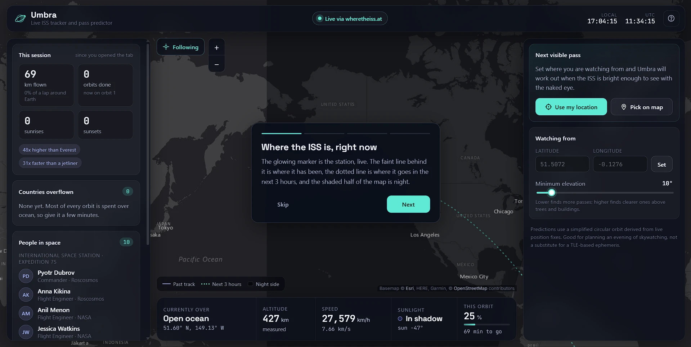

# Umbra: Live ISS Tracker and Naked-Eye Pass Predictor

[](https://github.com/HalcyonVector/Umbra/actions/workflows/ci.yml)

A live mission-control dashboard for the International Space Station. It shows where the station is right now on a real world map, the track it has flown and the path it takes next, the live day/night line, who is on board, and exactly when it will next pass over you bright enough to see with your own eyes. Each pass comes with a polar sky chart showing which direction to face, how high it climbs and where it sets. The predictor is built from scratch: it derives the orbit from consecutive live position fixes and checks the real astronomical condition for a visible pass (station sunlit, your sky dark, both lined up), not a lookup table.

Built with React, TypeScript, Leaflet and Express, entirely on free, keyless public data (wheretheiss.at, Open Notify and a community crew feed), running for $0/month on Render.

> **What it's for:** leave it open in a tab to watch the station cross the planet in real time, then set your location and find out when to step outside and look up.

**Live demo:** [umbra-0nnj.onrender.com](https://umbra-0nnj.onrender.com/) (Render's free tier sleeps when idle, so the first load can take up to a minute)



---

## Disclaimer

This project is for personal and educational use. It is **not a spaceflight-tracking tool, a scientific instrument, or a safety-critical application of any kind**, and makes no claims to that effect. Position, altitude and speed come from free hobby APIs with no uptime guarantee. Pass predictions come from a simplified orbit model derived from those positions (see Honest Limitations), so treat the times as good estimates for planning an evening of skywatching, not as precise ephemeris. For exact times, use a TLE-based tool such as NASA's Spot the Station or Heavens-Above.

---

## Findings

Real problems found while building and running this, and what changed:

- **The predictor was missing most real passes.** The visibility check treated the ISS as sunlit only when the ground directly beneath it was in daylight. From about 420 km up, the station keeps seeing the sun until the sun is roughly 20 degrees below the horizon under it, which is exactly why passes happen after dusk and before dawn. With the altitude-aware check (`isSatelliteSunlit`), locations that showed "no passes in 10 days" in testing now get several.
- **A fixed orbit plane made some cities look permanently unlucky.** Without J2 nodal precession (Earth's equatorial bulge swinging the orbit plane about 5 degrees per day), the ground track met an observer's dusk or dawn at almost the same times every day, so Bangalore showed no passes for the whole 10-day search. With precession modelled, visible-pass windows come and go the way they really do.
- **The map broke silently in production.** CARTO's free dark tiles started requiring an API key, so the deployed map was covered in "API KEY REQUIRED" watermarks. It now uses Esri's keyless World Dark Gray Canvas.
- **The night shading had a hard edge at the date line.** The overlay covered only one copy of the world, so a view centred near 180 degrees left the far side unshaded. It now spans three world widths.
- **Altitude and speed were estimates.** Open Notify reports only latitude and longitude. Switching the primary feed to wheretheiss.at gives measured altitude and velocity, with Open Notify kept as the fallback.
- **A sunset was counted on every page load.** The sunlight state started as a placeholder "day", so the first real reading in Earth's shadow counted as a sunset. Counting now starts at the first real fix.
- **Countries near the antimeridian matched wrongly.** Fiji's bounding box wraps the 180 degree line, and a naive box test reported the station over Fiji while it was over Peru. Fixed in the country lookup.

---

## Features

### Live Map

- **Full-screen map** (Leaflet with Esri Dark Gray Canvas tiles) with the station's position, a fading trail of where it has been, a dotted preview of the next 3 hours, and the night side of Earth shaded from the analytically solved terminator.
- **Follow mode** keeps the station centred. Drag the map and it lets go; one click brings it back.
- **Click the map to set your viewing spot**, with an amber "You" marker.
- **Seamless world wrap:** every layer is re-anchored to the world copy in view, so nothing vanishes or tears at the date line.
- The ground track you have seen **persists across visits** (24 hours, capped at 4,000 points).

### Live Telemetry

- **Currently over:** the country (or open ocean) below the station, from an offline point-in-polygon lookup against bundled country borders.
- **Measured altitude and speed** from the live feed, with derived fallbacks when only position is available.
- **Sunlight:** whether the station itself is in sunlight or Earth's shadow, using the altitude-aware shadow test.
- **Orbit progress** through the current ~93 minute orbit.
- **Feed status** in the header: live (and which feed), acquiring, or signal lost with the age of the last fix.

### Pass Predictor

- **Orbit determination from two fixes:** given the ISS's known inclination (51.6 degrees) and period, a single position plus direction of travel is enough to solve for the orbit in closed form (`orbital/groundTrackPropagator.ts`).
- **Propagation** forward hours or days, including Earth's rotation and J2 nodal precession.
- **Visibility walk:** every 15 seconds of predicted time for 24 hours, checks that the station is above your horizon, sunlit, and that your sky is past civil twilight, then groups the hits into passes.
- **Countdown and upcoming passes** with day, time, length, peak elevation, rise direction and a Great / Good / Low rating.
- **Polar sky chart** (`components/SkyPlot.tsx`) of the next pass from rise to set, the same chart satellite trackers use.
- **10-day fallback:** when nothing is visible in 24 hours, it searches further for the next good pass rather than dead-ending.
- **Best view on Earth right now:** scans a ring around the station for the darkest place that can see it lit.
- **Minimum elevation slider** for horizons blocked by trees or buildings.

### Mission Panel

- **People in space:** the current crew with role and agency, grouped by station, plus the ISS expedition number.
- **This session:** distance flown, orbits completed, sunrises and sunsets the crew has seen, and every country overflown since the tab opened.
- **Milestone toasts** for distance, countries and orbits.

### PWA

- Installable app shell (`manifest.webmanifest` and a small service worker that never caches `/api/*`), network-first for the HTML so a new deploy is never stuck behind a stale cache.
- **Screen Wake Lock**, since leaving it open is the point.

### UI/UX: "Mission Control"

A full-bleed live map with glass panels floating over it: a header with the feed status and clocks, the Mission panel on the left, the Passes panel on the right, and a headline stat strip along the bottom. Teal marks the station and anything live, indigo the past track and night, amber the observer and daylight. Type is Inter for the interface, Space Grotesk for headings and JetBrains Mono for every number, with tabular figures so values don't jitter as they tick. On phones the panels become three tabs (Live map, Passes, Mission). A four-step intro explains the map on first visit and can be replayed from the help button.

### Resilience & Accessibility

- The server proxies and caches both feeds (4 seconds for position, 10 minutes for crew) and switches to the fallback automatically; malformed or non-finite coordinates are rejected rather than drawn.
- When both feeds are down the header says so, and the last derived orbit keeps the map moving rather than freezing or inventing data.
- Top-level `ErrorBoundary` with a plain-language fallback and Refresh button; raw diagnostics only in dev builds.
- Labelled controls, `aria-live` status and toasts, visible focus rings, and `prefers-reduced-motion` respected for every animation.

---

## Data Source

| Source | Type | API Key? | What It Provides |
|--------|------|----------|-------------------|
| [wheretheiss.at](https://wheretheiss.at/w/developer) | REST | No | Primary ISS position, altitude, velocity and sunlight state |
| [Open Notify](http://open-notify.org/) | REST | No | Fallback ISS position (`iss-now.json`) and crew census (`astros.json`) |
| [people-in-space](https://github.com/corquaid/international-space-station-APIs) | Static JSON | No | Crew roster with role, agency and ISS expedition |
| [Esri World Dark Gray Canvas](https://www.esri.com) | Map tiles | No | Dark basemap and place-name labels |
| [world-atlas](https://github.com/topojson/world-atlas) | Bundled TopoJSON | No | 110m country borders for the offline "currently over" lookup |

---

## Tech Stack

| Layer | Technology | Details |
|-------|-----------|---------|
| **Frontend Framework** | React 18 + TypeScript | Vite dev server and build, strict TS config |
| **Map** | Leaflet | Esri tiles, a custom pane for labels above the night shading |
| **Orbital Math** | Hand-written TypeScript | Orbit determination, J2 propagation, solar geometry, look angles; no astronomy library |
| **Backend Framework** | Express (Node.js, ESM) | Cached feed proxy with fallbacks, static hosting of the built client |
| **PWA** | Web App Manifest + Service Worker + Wake Lock API | Installable shell, screen-sleep prevention |
| **Testing** | Vitest + Supertest | Pure-logic unit tests (client) and HTTP route tests (server) |
| **CI** | GitHub Actions | Server and client tests plus a client build on every push and PR |
| **Hosting** | Render (free) | One web service from `render.yaml` |
| **Dev Orchestration** | `concurrently` + `cross-env` | One `npm run dev` for both servers; works in PowerShell |

---

## Prerequisites

- **Node.js 18+**: [Download here](https://nodejs.org/) (the server uses global `fetch` and `AbortSignal.timeout`)

No API keys, no database, no Docker required.

---

## Quick Start

```bash
npm install            # root dev tools (concurrently, cross-env)
npm run install:all    # server and client dependencies
npm run dev            # API on :3003 and Vite dev server on :5275 (proxies /api)
```

Open `http://localhost:5275`, then click **Use my location** or **Pick on map** in the Passes panel.

### Production

```bash
npm run build   # installs dependencies and builds the client into client/dist
npm start       # Express serves the API and the built client on one port
```

In dev, Vite (`:5275`) and the API (`:3003`) are two processes. In production there is no Vite: Express alone serves both from `PORT` (default `3003`).

### Deploying to Render

The repo includes a `render.yaml` Blueprint. In Render choose **New > Blueprint**, pick this repository and apply. That creates one free web service with:

- Build command: `npm install && npm run build`
- Start command: `npm start`
- Health check: `/api/health`

Render sets `PORT` itself, and every push to `main` redeploys.

### Tests

```bash
npm test
```

---

## Project Structure

```
Umbra/
├── README.md
├── LICENSE
├── package.json                         # Root scripts: install:all, dev, build, start, test
├── render.yaml                          # Render Blueprint: one free web service
├── .github/workflows/ci.yml             # Tests and build on every push and PR
├── docs/screenshots/                    # README images
│
├── server/
│   ├── src/
│   │   ├── index.js                     # Starts the server on PORT
│   │   ├── app.js                       # Express app, API routes, static client hosting
│   │   └── routes/
│   │       ├── iss.js                   # Position: wheretheiss.at, fallback Open Notify, 4s cache
│   │       └── astros.js                # Crew: people-in-space, fallback Open Notify, 10m cache
│   └── test/                            # Supertest route tests with mocked fetch
│
└── client/
    ├── index.html
    ├── public/                          # Manifest, service worker, icons
    └── src/
        ├── App.tsx                      # State, derived telemetry, prediction wiring
        ├── App.css                      # Design system and responsive layout
        ├── components/
        │   ├── MapScene.tsx             # Leaflet map, trails, night shading, follow and pick
        │   ├── TopBar.tsx               # Brand, feed status, clocks
        │   ├── StatStrip.tsx            # Headline telemetry
        │   ├── MissionPanel.tsx         # Session stats, countries, crew roster
        │   ├── PassPanel.tsx            # Countdown, passes, location settings
        │   ├── SkyPlot.tsx              # Polar sky chart
        │   └── IntroCard.tsx, ToastStack.tsx, ErrorBoundary.tsx
        ├── orbital/
        │   ├── groundTrackPropagator.ts # Orbit determination and J2 propagation
        │   ├── visibility.ts            # Look angles, station sunlight, visibility test
        │   ├── eventPrediction.ts       # Pass search, twilight timing, best view now
        │   ├── solarTerminator.ts       # Solar position and the day/night line
        │   ├── countryLookup.ts         # Offline point-in-polygon country lookup
        │   └── orbitalMechanics.ts, groundTrack.ts, greatCircle.ts
        ├── inputs/                      # useIssFeed, useCrewFeed, useWakeLock
        ├── lib/                         # Formatting, compass, persistence, milestones
        └── map/projection.ts            # Sky chart projection
```

---

## API Endpoints

| Method | Endpoint | Description |
|--------|----------|-------------|
| GET | `/api/iss` | Current position, plus altitude, velocity and sunlight state when the primary feed is up. Cached 4s |
| GET | `/api/astros` | Everyone currently in space, with role, agency and expedition when available. Cached 10 min |
| GET | `/api/health` | Liveness check |

---

## Configuration

| Variable | Default | Description |
|----------|---------|-------------|
| `PORT` | `3003` | Port for the Express server (Render sets this automatically) |

---

## Architecture

```
   ┌──────────────────┐   ┌──────────────────┐   ┌────────────────────┐
   │ wheretheiss.at    │   │ Open Notify       │   │ people-in-space     │
   │ position, alt, v  │   │ fallback feeds    │   │ crew roster         │
   └────────┬─────────┘   └────────┬─────────┘   └─────────┬──────────┘
            └──────────────┬───────┴───────────────────────┘
                ┌──────────▼───────────────────────┐
                │ Express (Render / :3003)           │
                │ /api/iss (4s)  /api/astros (10m)   │
                │ fallback switching, validation     │
                └──────────┬───────────────────────┘
                           │ polled every 5s / 5 min
                ┌──────────▼───────────────────────┐
                │ React client                       │
                │ useIssFeed · useCrewFeed           │
                └──────────┬───────────────────────┘
                           │ two consecutive fixes
                ┌──────────▼───────────────────────┐
                │ groundTrackPropagator.ts           │
                │ derive orbit, propagate with J2    │
                └─────┬────────────────────┬───────┘
                      │                    │
       ┌──────────────▼──────────┐  ┌──────▼─────────────────────────┐
       │ eventPrediction.ts        │  │ MapScene.tsx                    │
       │ visibility.ts             │  │ marker, trails, next 3h,        │
       │ passes, sky chart, best   │  │ night shading (solarTerminator) │
       └──────────────┬──────────┘  └────────────────────────────────┘
                      │
       ┌──────────────▼──────────────────────────┐
       │ StatStrip · MissionPanel · PassPanel      │
       └──────────────────────────────────────────┘
```

How a pass prediction is made:

1. **Fix:** the client polls `/api/iss`; each new timestamp is a position fix.
2. **Orbit:** two consecutive fixes give a direction of travel, which with the known inclination and period solves for the orbit.
3. **Propagate:** the orbit is stepped forward with Earth's rotation and J2 nodal precession.
4. **Test:** at every step, the station must be above your minimum elevation, in sunlight, and your sky past civil twilight.
5. **Group:** consecutive visible steps become a pass with a rise-to-set azimuth/elevation track for the sky chart.

---

## Testing

```bash
npm test
```

**Client (158 tests, Vitest):** every pure module in `orbital/`, `map/` and `lib/` has a suite with physical-sanity checks. The vis-viva speed reproduces the ISS's real ~7.66 km/s, the period-to-altitude round trip matches its ~92.7 minutes, J2 precession reproduces its real ~-5 degrees per day, the propagated track never exceeds the inclination, orbit determination recovers a known ground truth, and the visibility tests use geometrically engineered cases (a station just past the ground terminator but still sunlit, one deep in Earth's shadow, an observer just past civil twilight) rather than hoping a real pass exists on a given date.

**Server (11 tests, Supertest):** normalisation of both feeds, fallback switching when the primary fails, caching, and 502s (not crashes) on malformed coordinates or when every upstream is down, all against a mocked `fetch`.

`MapScene.tsx` is excluded from unit tests; the map is checked in a real browser instead. Both suites run in CI on every push.

---

## Honest Limitations

- **Simplified orbit model.** Circular orbit at a fixed inclination with J2 nodal precession, but no atmospheric drag or eccentricity. Good for an evening's planning, less precise a few days out.
- **No atmospheric refraction** in the sunlight and twilight tests, so times right at the edges can be off by a little.
- **Coarse borders.** "Currently over" uses 110m-resolution outlines, so it can be wrong near coastlines and small islands.
- **Free upstream services.** None of the feeds has an uptime guarantee. When both position feeds are down, the app keeps propagating the last derived orbit and says so in the header.
- **"People in space" isn't ISS-only.** The roster includes other crewed stations, such as Tiangong, grouped separately.
- **Map tiles need a connection.** The basemap has no offline fallback.
- **Render's free tier sleeps when idle**, so the first visit after a quiet spell is slow.
- **Session stats reset on reload** by design; only the ground track persists.

---

## Suggested Future Features

- **TLE/SGP4 propagation** as an optional precise source, falling back to the derived orbit.
- **Pass reminders** via browser notifications a few minutes before a visible pass.
- **City search** for setting the viewing location.
- **Brightness (magnitude) estimates** for each pass.
- **A log of observed passes** you confirm you actually saw.

---

## Author

**Sagnik**

GitHub: [@HalcyonVector](https://github.com/HalcyonVector)

---

## 📄 License

MIT License. See [LICENSE](./LICENSE). Free to use, modify, and distribute, with no warranty.
